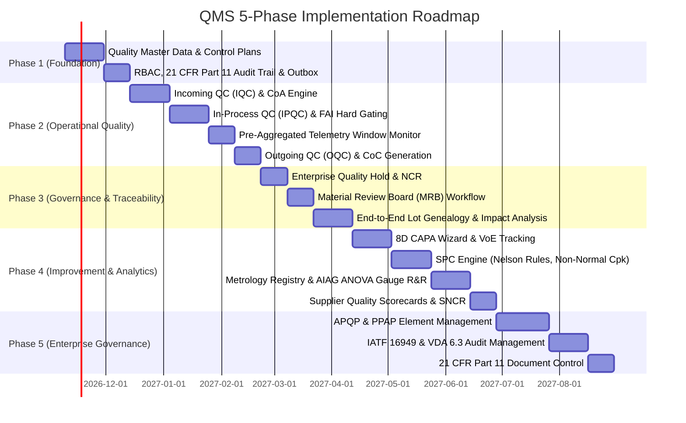

# Product Requirements Document — Quality Management System (QMS)

> **Status:** `PLANNING` — Enterprise Quality Governance & Metrology Blueprint (v2.0)
> **Purpose:** Single source of truth for product vision, user stories, domain responsibilities, and phased delivery features.

---

## 1. Product Vision

### Elevator Pitch

The Quality Management System (QMS) is an enterprise-grade quality governance, metrology, and compliance platform designed specifically for precision automotive plastic injection molding plants. It orchestrates the entire quality lifecycle—from APQP launch planning and PPAP part approval, incoming material inspection (IQC) with supplier scorecards, in-process injection monitoring (IPQC) with pre-aggregated telemetry gating, and outgoing verification (OQC) with Certificate of Conformance (CoC) release, to Material Review Board (MRB) non-conformance disposition, 8D CAPA problem-solving, deep multi-tier lot genealogy, and non-normal Statistical Process Control (SPC)—serving as the authoritative decision owner for product, material, and process release across the enterprise.

### Problem Statement

Tier 1 and Tier 2 automotive injection molding facilities face severe compliance, financial, and operational risks due to disconnected quality practices:

1. **Passive QC "Silo Recording" vs Active Quality Governance:** Traditional QC software functions merely as a digital logbook after defects occur, rather than an active quality gate that deterministically stops production lines, rejects unapproved machine setups, or locks warehouse inventories.
2. **Quality Hold Bypasses & Traceability Breaches:** Under production pressure, material lots with unverified Certificates of Analysis (CoA) or high moisture content are loaded into machine hoppers, resulting in massive scrap runs (splay, silver streaks, brittleness) and costly customer recalls. Plants lack instant backward/forward impact analysis to answer: *"If resin lot X failed, which finished cartons were molded from it and where were they shipped?"*
3. **Disconnected First-Piece Approval & Process Drift:** Operators begin serial production before Quality Engineers verify critical dimensions (CMM) and resin cushion limits, violating IATF 16949 requirements and leading to out-of-tolerance batches.
4. **Shallow Non-Conformance Dispositions:** Non-conformance reporting lacks formal cross-functional Material Review Board (MRB) governance, resulting in inappropriate scrap vs. rework decisions or unapproved concessions (`Use-As-Is`) that compromise customer specifications.
5. **Measurement Inaccuracy & Calibration Gaps:** Decisions are made using uncalibrated digital calipers, torque wrenches, or moisture analyzers with unknown Gauge R&R variability, compromising statistical validity.
6. **APQP & PPAP Disconnect:** Quality planning is treated as isolated paperwork rather than living digital Control Plans tied directly to shopfloor inspection routines and engineering change revisions.

### Target Users & Organizational Roles

In accordance with automotive IATF 16949 governance, the QMS is operated primarily by the **Quality Assurance & Quality Control (QA/QC) Department**, with strict separation between inspection execution, verification, and disposition authority.

| Role | Description | Primary Need |
| :--- | :--- | :--- |
| **Quality Director / VP** | Executive Quality Leader with enterprise-level oversight | Enterprise quality KPIs (PPM, Cost of Poor Quality / CoPQ), customer audit compliance, IATF certification oversight, and global CAPA governance. |
| **Quality Manager** | Plant Quality Authority responsible for site governance | Plant quality strategy, overseeing inspection throughput, approving high-risk MRB dispositions (`Use-As-Is`, Scrap > $10k), and customer escalation management. |
| **QA Supervisor** | Shift & Area Quality Lead managing floor inspection operations | Daily shift supervision, allocating inspectors across IQC/IPQC/OQC, reviewing inspection sample records, and tracking open containment actions. |
| **Quality Engineer (QE)** | Engineering specialist driving standards and problem solving | Authoring Control Plans, establishing CTQ tolerances, leading 8D Root Cause Analysis (RCA), managing CAPA workflows, and monitoring real-time SPC $C_{pk}$ trends. |
| **Supplier Quality Engineer (SQE)** | Specialist governing supplier performance & incoming standards | Managing supplier qualifications, conducting supplier quality audits, tracking vendor PPM and CoA compliance scorecards, and issuing Supplier NCRs (SNCR). |
| **MRB Committee Member** | Cross-functional authority (QA, Engineering, Tooling, Operations) | Evaluating non-conforming batches, conducting risk assessments, and voting on formal dispositions (`REWORK`, `REPAIR`, `SCRAP`, `USE_AS_IS`, `RTV`, `SORTING`). |
| **IQC Inspector** | Dock & Receiving Quality Controller | Inspecting incoming raw resins (PP, ABS, PC) and masterbatches, validating supplier CoAs, recording moisture/MFI tests, and asserting Pass/Reject status. |
| **IPQC Inspector** | Shopfloor In-Process Quality Controller | Conducting First-Piece Inspections (FAI), running hourly patrol rounds across injection machines, logging visual/dimensional defects, and issuing line stops. |
| **OQC / Final Inspector** | Packaging and Finished Goods Quality Controller | Final CMM checks, packaging integrity audits, cosmetic acceptance sampling (AQL/c=0), and issuing formal Quality Clearance / CoC for shipment. |
| **Metrologist / Tool Custodian** | Calibration & Gauge Custodian in Metrology Lab | Managing gauge master data, executing calibration routines, tracking certificate expiration, and conducting MSA (Gauge R&R, ANOVA). |
| **Document Controller** | Quality Compliance Administrator | Administering Quality Manual, SOPs, Control Plans, and Work Instructions under strict revision control and distribution workflows. |
| **Lead Quality Auditor** | Internal & Process Quality Auditor | Planning and conducting internal audits (IATF 16949 / ISO 9001), process audits (VDA 6.3), supplier audits, and tracking audit finding remediations. |

---

## 2. System Boundaries & Enterprise Data Ownership

The QMS does not duplicate ERP, MES, WMS, or MMS. Instead, it serves as the **Authoritative Quality Decision Owner**:

```text
┌─────────────────────────────────────────────────────────────────────────────────┐
│                                 ERP (Level 4)                                   │
│            • Master Supplier & POs          • Customer Sales Orders & Shipments │
│            • Material / SKU Master          • Cost of Poor Quality (CoPQ)       │
└───────────────▲─────────────────────────────────────────────────▲───────────────┘
                │ (Supplier Code, PO, SKU Sync)                   │ (IQC & OQC Status)
                ▼                                                 ▼
┌─────────────────────────────────────────────────────────────────────────────────┐
│                                 QMS (Level 3/4)                                 │
│  APQP/PPAP │ Control Plans │ IQC │ IPQC │ OQC │ NCR/MRB │ CAPA │ SPC │ MSA │ Audit│
│                       [AUTHORITATIVE QUALITY DECISION OWNER]                   │
└───────▲───────────────────────────────▲─────────────────────────────────▲───────┘
        │ (Incoming Lot, Quarantine)    │ (Run, Aggregated Telemetry, FAI)│ (Calibration)
        ▼                               ▼                                 ▼
┌──────────────────────┐    ┌──────────────────────┐    ┌──────────────────────┐
│     WMS (Level 3)    │    │     MES (Level 3)    │    │     MMS (Level 3)    │
│ • Raw & FG Storage   │    │ • Shopfloor Execution│    │ • Machine Tooling    │
│ • Bin Movements      │    │ • Cycle Aggregations │    │ • Mold Preventive PM │
│ • Physical Staging   │    │ • Production Runs    │    │ • Breakdown Repairs  │
│ • Shipping Docks     │    │ • Digital Travelers  │    │ • Mold Shot Counts   │
└──────────────────────┘    └──────────────────────┘    └──────────────────────┘
```

### Responsibility & Data Ownership Matrix

| Dimension | ERP | MES | WMS | QMS | MMS |
| :--- | :--- | :--- | :--- | :--- | :--- |
| **Core Responsibility** | Commercial, procurement, finance, costing | Production execution, shopfloor tracking, OEE | Inventory balances, bin movements, logistics | Quality standards, inspections, NCR, MRB, CAPA, quality disposition | Machine/tooling reliability, PM schedules, mold maintenance |
| **Supplier Master** | **Owner** (Vendor Code, Name, Address, Terms, Payment) | Consumer | Consumer | **Consumer & Quality Owner** (Supplier Qualification, Audits, Scorecards, SNCR) | Consumer |
| **Production Execution**| Consumer (Work orders) | **Owner** (Machine run status, shot counts, operator login) | Consumer | **Quality Gating** (FAI release token, process envelope limits, line stops) | Consumer (Tool counters) |
| **Inventory & Location**| Consumer (Financial stock) | Consumer (WIP consumed) | **Owner** (Bin locations, pallet IDs, physical movements) | **Status Owner** (`AVAILABLE`, `QA_HOLD`, `QUARANTINE`, `REJECTED`) | Consumer (Spares inventory) |
| **Equipment & Gauges** | Asset register (Financial depreciation) | Consumer (Machine runtime) | Consumer | **Owner of Metrology** (Gauge master, calibration certificates, Gauge R&R, measurement lockout) | **Owner of Machinery** (Hydraulic seals, platens, heaters, mold repairs) |

---

## 3. User Stories / Use Cases

### Epic 1: Advanced Product Quality Planning & PPAP (P1)

| ID | User Story | Priority | Acceptance Criteria |
| :--- | :--- | :---: | :--- |
| `US-APQP-001` | As a **Quality Engineer**, I want to manage APQP project milestones (Phase 1 to Phase 5) linked to automotive OEM launch gates so that all deliverables are tracked before serial production. | `P1` | System tracks 5 APQP phases, gateway reviews, deliverables status, and links to engineering change revisions (ECN). |
| `US-APQP-002` | As a **Quality Engineer**, I want to assemble an electronic PPAP package (Level 1–5, 18 AIAG elements) including Part Submission Warrant (PSW) and dimensional reports so that customer approval is formally secured. | `P1` | Generates AIAG PPAP submission package; verifies presence of all 18 elements including signed PSW, design records, and $P_{pk} \ge 1.67$ capability evidence. |

### Epic 2: Quality Planning & Control Plans (P0)

| ID | User Story | Priority | Acceptance Criteria |
| :--- | :--- | :---: | :--- |
| `US-QP-001` | As a **Quality Engineer**, I want to create a versioned Control Plan for part `PRD-AUTO-BUMPER` linking drawing dimensions to inspection methods so that inspectors follow certified IATF standards. | `P0` | System allows adding variable and attribute characteristics with USL, LSL, target, tool type, sample frequency, and inspection stage; requires QA Manager approval before release. |
| `US-QP-002` | As a **Quality Engineer**, I want to update an Inspection Plan to `REV-B` when an Engineering Change Notice (ECN) arrives so that obsolete tolerances cannot be inspected. | `P0` | System archives `REV-A`, marks it obsolete, mandates change notes, and automatically propagates `REV-B` to active shopfloor inspection terminals. |

### Epic 3: Supplier Quality Management & Incoming QC — IQC (P0)

| ID | User Story | Priority | Acceptance Criteria |
| :--- | :--- | :---: | :--- |
| `US-IQC-001` | As an **IQC Inspector**, I want to scan incoming resin bags of `RES-ABS-HI` and evaluate the supplier's CoA against raw material specifications so that non-compliant chemical grades are rejected at the dock. | `P0` | System verifies moisture $\le 0.02\%$ and MFI within $18 \pm 2\text{ g/10min}$; if out of tolerance, blocks acceptance and flags lot as `QA_HOLD`. |
| `US-IQC-002` | As a **Warehouse Handler**, I want the WMS to automatically update lot status to `AVAILABLE` when IQC marks a lot `ACCEPTED` so that I can stage it to machines without manual paperwork. | `P0` | QMS transactional outbox emits `qms.lot_released` event; WMS ledger records movement from QC Cage to Available RM storage within $< 1\text{ second}$. |
| `US-IQC-003` | As an **SQE**, I want rejected material to generate an automated Supplier NCR (SNCR) and update the supplier's PPM scorecard so that purchasing can take commercial action. | `P0` | Generates SNCR record with photo evidence, updates WMS lot to `QUARANTINE`, adjusts supplier rating metrics, and exports summary to ERP. |

### Epic 4: In-Process Quality Control & First-Piece Gating — IPQC (P0)

| ID | User Story | Priority | Acceptance Criteria |
| :--- | :--- | :---: | :--- |
| `US-IPQC-001` | As an **IPQC Inspector**, I want to perform a First-Piece Inspection (FAI) on `IMM-01` after mold setup and submit my sign-off so that the machine can begin serial production. | `P0` | QMS validates all cavity samples pass tolerance; dispatches signed authorization to MES `POST /api/v1/integration/qms/qc-release`; MES run transitions from `SETUP` to `RUNNING`. |
| `US-IPQC-002` | As a **Machine Operator**, I want the MES to refuse starting production runs if First-Piece QC is missing so that unapproved parts are never produced. | `P0` | MES displays hard error and disallows starting serial run until cryptographic QMS release token is received. |
| `US-IPQC-003` | As an **IPQC Inspector**, I want the QMS to evaluate pre-aggregated machine telemetry (screw cushion, peak injection pressure) sent by MES so that process window drift triggers an immediate alert. | `P0` | Ingests per-cycle summary aggregates; if cushion position drifts beyond $\pm 0.5\text{ mm}$ for 3 consecutive shots, triggers Andon alert and prompts for intervention. |
| `US-IPQC-004` | As an **IPQC Inspector**, I want to conduct hourly patrol inspections and log defect counts (sink marks, flash) so that real-time scrap trends are tracked. | `P0` | System accepts dimensional values and defect counts; if defect count $> 2.5\%$, system triggers an Andon alert and prompts for immediate line intervention. |

### Epic 5: Outgoing Quality Control & Quality Clearance — OQC (P0)

| ID | User Story | Priority | Acceptance Criteria |
| :--- | :--- | :---: | :--- |
| `US-OQC-001` | As an **OQC Inspector**, I want to execute final acceptance sampling on finished goods cartons using ISO 2859-1 Level II normal inspection ($c=0$ plan) so that only defect-free lots leave the facility. | `P0` | System calculates sample size based on batch quantity; enforces zero-defect criteria; a single defect blocks the entire finished goods batch. |
| `US-OQC-002` | As an **OQC Inspector**, I want to verify packaging integrity, desiccant presence, ESD bag sealing, and barcode labels against customer packaging specs. | `P0` | Enforces checklist completion and 2D DataMatrix scan verification before allowing final clearance. |
| `US-OQC-003` | As an **OQC Inspector**, I want to generate a signed electronic Certificate of Conformance (CoC) and notify WMS so that cartons are released for shipment picking. | `P0` | Generates tamper-evident PDF CoC; emits `qms.coc_released` event to WMS; un-cleared cartons remain locked from Delivery Order (DO) picking. |

### Epic 6: Non-Conformance Management & Material Review Board — NCR / MRB (P0)

| ID | User Story | Priority | Acceptance Criteria |
| :--- | :--- | :---: | :--- |
| `US-NCR-001` | As a **Quality Supervisor**, I want to declare a Quality Hold on raw lot `LOT-PP-202610-01` so that both warehouse and production lines immediately cease using the affected material. | `P0` | QMS updates lot status to `QA_HOLD`; outbox worker broadcasts hold event; WMS blocks bin picking; MES rejects hopper load requests in $< 200\text{ms}$. |
| `US-NCR-002` | As an **MRB Committee Member**, I want to review an NCR and vote on a formal disposition (`REWORK`, `REPAIR`, `SCRAP`, `USE_AS_IS`, `RETURN_TO_SUPPLIER`, `SORTING`, `REINSPECTION`) with auditable rationale. | `P0` | Provides structured MRB workflow; records votes and justification; routes to secondary rework order or financial write-off. |
| `US-NCR-003` | As a **Quality Manager**, I want any concession disposition (`USE_AS_IS`) to mandate dual four-eyes approval (Quality Manager + Chief Engineer + Customer CSR) so that safety criteria are never bypassed. | `P0` | System strictly blocks `USE_AS_IS` without dual digital signature re-authentication and attached customer concession approval document. |

### Epic 7: Corrective and Preventive Action — CAPA 8D (P0)

| ID | User Story | Priority | Acceptance Criteria |
| :--- | :--- | :---: | :--- |
| `US-CAPA-001` | As a **Quality Engineer**, I want to initiate an 8D CAPA for recurring defects or critical NCRs so that root causes are systematically eliminated. | `P0` | System provides 8D workflow wizard (D1 to D8), requiring completed 5-Why analysis and Fishbone diagram before allowing advancement to Permanent Corrective Action (PCA). |
| `US-CAPA-002` | As a **Quality Manager**, I want to track 30-day, 60-day, and 90-day Verification of Effectiveness (VoE) before closing a CAPA so that solutions are proven permanent. | `P0` | System maintains CAPA in `MONITORING` state; confirms zero repeat defects over the evaluation window prior to administrative closure. |

### Epic 8: Quality Traceability & Genealogy (P0)

| ID | User Story | Priority | Acceptance Criteria |
| :--- | :--- | :---: | :--- |
| `US-TRC-001` | As a **Quality Engineer**, I want to run a reverse impact analysis from a defective raw resin lot to identify all finished goods cartons and customer shipments containing that lot. | `P0` | Traverses the genealogy graph in $< 2\text{ seconds}$: `Resin Lot` $\to$ `Hopper Staging` $\to$ `MES Run` $\to$ `Carton Barcode` $\to$ `WMS Outbound DO`; outputs complete containment list. |
| `US-TRC-002` | As an **Auditor**, I want forward traceability from a customer serial number back to the raw material CoA, mold cavity, FAI release, and machine telemetry window. | `P0` | Displays interactive genealogy tree with clickable links to all associated inspection records, calibration certificates, and digital signatures. |

### Epic 9: Statistical Process Control & Analytics — SPC (P1)

| ID | User Story | Priority | Acceptance Criteria |
| :--- | :--- | :---: | :--- |
| `US-SPC-001` | As a **Quality Engineer**, I want real-time $\bar{X}-R$ and $\bar{X}-s$ control charts for critical bumper width ($1450 \pm 2\text{ mm}$) with automated Nelson Rules 1–8 violation detection. | `P1` | Dynamically plots control charts; highlights rule breaches within 500ms of sample entry; triggers automated containment task upon Rule 1 or Rule 2 breach. |
| `US-SPC-002` | As a **Quality Engineer**, I want automated normality testing (Anderson-Darling) and Box-Cox transformations for GD&T characteristics to compute statistically valid $C_{pk} / P_{pk}$ under ISO 21747. | `P1` | Evaluates distribution normality; optimizes $\lambda$ parameter; calculates $C_{mk}, P_{pk}, C_{pk}$ and flags any process where $C_{pk} < 1.33$. |

### Epic 10: Metrology, Calibration & Gauge MSA (P1)

| ID | User Story | Priority | Acceptance Criteria |
| :--- | :--- | :---: | :--- |
| `US-MSA-001` | As an **Inspector**, I want the system to block me from recording measurements with a caliper whose calibration is expired so that inspection integrity is never compromised. | `P1` | System validates gauge ID; if `status === 'OVERDUE'`, displays red modal warning and disables input fields. |
| `US-MSA-002` | As a **Quality Engineer**, I want to conduct a 10-part, 3-operator, 3-trial Gauge R&R study using ANOVA to certify metrology compliance under AIAG MSA 4th Edition. | `P1` | Performs ANOVA calculations; outputs $\%GRR$, number of distinct categories ($ndc$); confirms whether the measurement system is acceptable ($\%GRR \le 10\%$, $ndc \ge 5$). |

### Epic 11: Document Control & Audit Governance (P2)

| ID | User Story | Priority | Acceptance Criteria |
| :--- | :--- | :---: | :--- |
| `US-AUD-001` | As a **Lead Quality Auditor**, I want to schedule and execute IATF 16949 and VDA 6.3 process audits with standardized clause checklists and automated CAPA finding creation. | `P2` | Provides audit calendar, scoring matrices, non-conformance classification (Major, Minor, OFI), and automated escalation to 8D CAPA. |
| `US-AUD-002` | As a **Document Controller**, I want strict versioning and dual electronic signature workflows for Quality Manuals, SOPs, and Work Instructions with automated floor revoking. | `P2` | Manages document lifecycle (`DRAFT` $\to$ `RELEASED` $\to$ `OBSOLETE`); prompts floor operators to digitally acknowledge updated instructions on next shift login. |

---

## 4. Phased Delivery Roadmap



---

## 5. Constraints & Assumptions

### Technical Constraints
1. **Modular Monolith Architecture:** Implemented in Python 3.12 / Django 5.x with 16 domain apps, PostgreSQL 16, Redis 7, and Celery 5.4 inside Docker Compose.
2. **Transactional Outbox for Event Dispatch:** Multi-system events (`qms.quality_hold_declared`, `qms.lot_released`, `qms.fai_released`) must be persisted atomically in `outbox_events` table before relaying via Celery to ensure zero event loss during network drops.
3. **Pre-Aggregated Telemetry Ingestion:** QMS ingests per-shot cycle summary aggregates from MES (cushion $\pm 0.5\text{ mm}$, peak pressure, fill time), rather than raw 1kHz analog waveform signals.
4. **Sub-Second Hard Gating:** FAI release handshakes to MES must complete with latency $< 200\text{ms}$.
5. **Fail-Safe Default:** If companion systems are unreachable during a Quality Hold declaration, QMS maintains a local lock and trips high-priority Andon alerts. Companion systems must fail-safe (block usage if connection is severed).
6. **Audit Trail Immutability:** Append-only cryptographic SHA-256 hash chains. Database triggers forbid `UPDATE` and `DELETE` on all inspection and audit records.

### Business & Domain Assumptions
1. Master supplier identities are standardized on enterprise ERP codes (`VEND-LOTTE`, `VEND-INEOS`, `VEND-CLARIANT`), eliminating duplicate vendor records.
2. The facility comprises 10 discrete injection molding machines (`IMM-01` to `IMM-10`) producing automotive parts (`PRD-AUTO-BUMPER`, `PRD-DOOR-TRIM`, `PRD-HVAC-DUCT`) using approved molds (`MOLD-BUMP-2C`, `MOLD-TRIM-4C`, `MOLD-DUCT-2C`).
3. Quality dispositions take precedence over production deadlines; neither production supervisors nor warehouse managers possess permissions to override an active `QA_HOLD`.
4. MMS manages machine maintenance (pumps, hydraulics, tool sharpening), while QMS exclusively manages measurement instrument calibration (calipers, micrometers, CMM).

---

## 6. Success Metrics

| Metric | Target Baseline | Target Post-Implementation | Measurement Method |
| :--- | :--- | :--- | :--- |
| **Customer Defect PPM** | $< 120\text{ PPM}$ | $< 15\text{ PPM}$ | Total customer rejected parts per million parts shipped. |
| **Scrap Rate (% of Total Material)** | $3.8\%$ | $< 1.2\%$ | Total scrapped material weight vs total consumed resin weight. |
| **Unapproved Production Runs** | $> 0\text{ incidents/year}$ | **0 incidents** (Zero Tolerance) | Audit count of serial runs operated without signed FAI releases. |
| **Reverse Traceability Latency** | $> 4\text{ hours}$ | $< 2\text{ seconds}$ | Time to identify all finished goods cartons containing a defective resin lot. |
| **Mean Time to Contain (MTTC)** | $> 4\text{ hours}$ | $< 3\text{ minutes}$ | Elapsed time from defect identification to multi-system hold. |
| **8D CAPA On-Time Closure Rate** | $62\%$ | $> 95\%$ | Percentage of CAPAs resolved within the defined SLA window. |
| **Process Capability ($C_{pk}$)** | Unknown / $1.05$ avg | $\ge 1.45$ across CTQs | Automated SPC calculation engine across key variable dimensions. |
| **Gauge Calibration Compliance** | $88\%$ | **100%** (Enforced) | Automated lockouts preventing out-of-calibration gauge usage. |

---

## 7. Out of Scope

**The following will not be built in this version:**

1. **Enterprise Financial Costing:** Detailed general ledger accounts and commercial warranty chargeback settlements (owned by ERP Accounts Payable / Accounts Receivable).
2. **Physical Tool Re-machining:** Physical CNC machining and EDM mold repair operations (owned by Tooling / MMS).
3. **Direct Machine PLC Parameter Tweaking:** QMS monitors pre-aggregated process envelopes, but does not write to PLC holding registers or execute closed-loop temperature adjustments (maintained under edge controller safety governance).
4. **Laboratory Information Management (LIMS) for R&D Syntheses:** Pure chemical polymer synthesis research beyond incoming lot CoA verification and baseline melt-flow testing.
